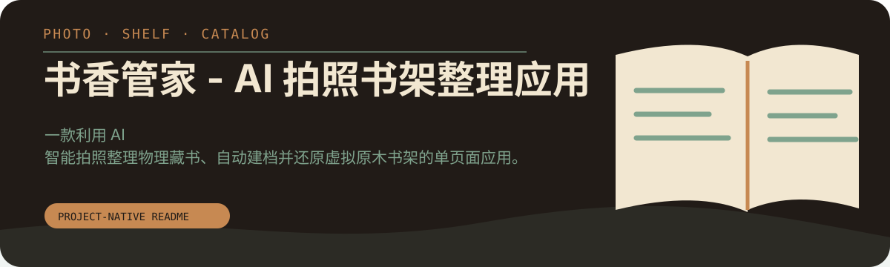
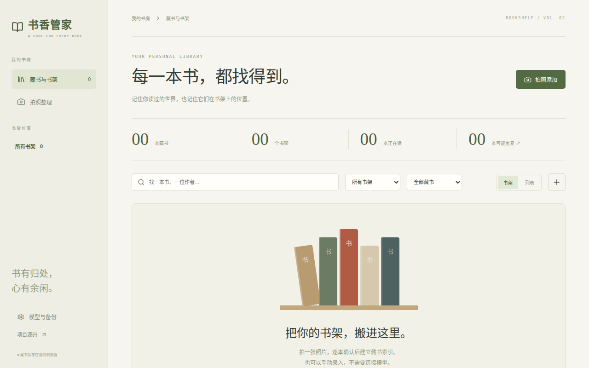
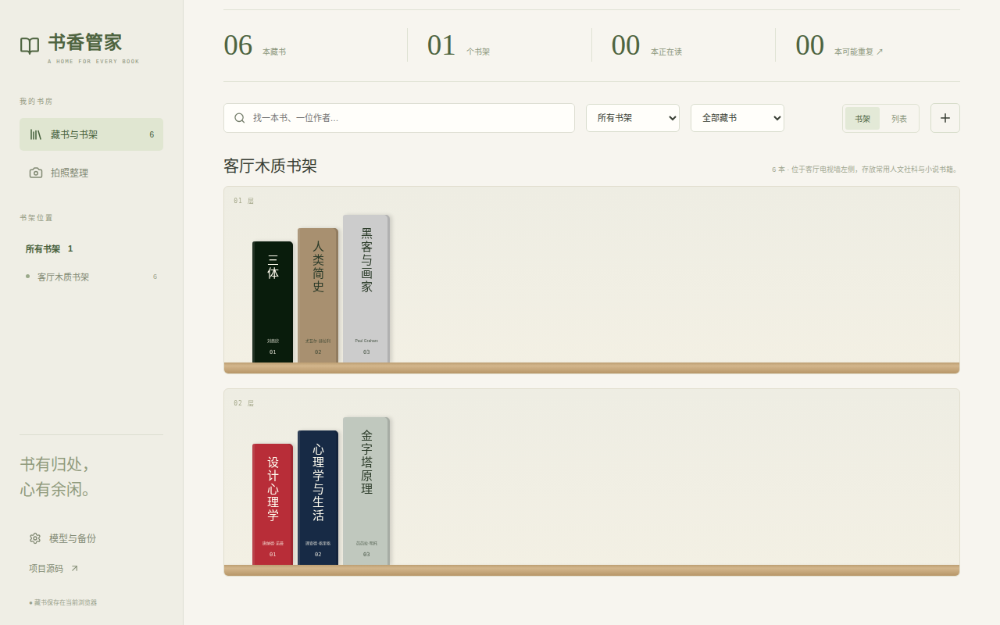

<p align="right"><a href="README.md">中文</a></p>

<p align="center">
  
</p>

<p align="center">
  <a href="https://xiaosang.cc/bookshelf-manager/">▶ Use Online</a>
  ·
  <a href="https://holynova.github.io/bookshelf_manager/">GitHub Pages mirror</a>
  ·
  <a href="https://github.com/holynova/bookshelf_manager">GitHub Repository</a>
</p>

Bookshelf Manager (书香管家) catalogs your physical books: photograph a shelf, and an AI model reads the spines (title, author, shelf row, left-to-right position) for you to verify book by book — or enter books manually. A virtual shelf mirrors your real one row by row, so you always know where a book lives. Data stays in your browser (IndexedDB); export JSON backups regularly.

## Screenshots

<p align="center">
  
</p>

<p align="center">
  
</p>

## Workflow

1. Upload a shelf photo, or enter books manually.
2. Configure any Chat Completions-compatible API that takes images and returns JSON. Photos are sent only when you click recognize, and recognition is cancellable.
3. Check title, author, row, and left-to-right position, then append to a new or existing shelf.
4. Search, browse spine / list views, edit notes, set read status （未读 unread / 在读 reading / 已读 read), and find suspected duplicate books.
5. Export JSON backups regularly; import is a transactional merge — it never clears your existing books, and re-importing the same archive adds zero records.

## Details

- **Recognition shows its evidence**: uncertain fields from the model are flagged for review; no unverified Douban ratings are generated or shown; bounding-box overlays on the original photo appear only when the model returns a valid box that matches the image.
- **Appending never loses old data**: appending to an existing shelf keeps the old shelf photo; the new photo's box positions are not used.
- **Demo study**: no demo data is loaded automatically on first open — you load it yourself. The demo verification uses preset samples, not model recognition results.
- **Privacy**: a newly entered API key lives in the current tab's sessionStorage only and never enters backups; books don't sync across devices, so export before clearing site data.
- **Data compatibility**: keeps using the existing `BookshelfDatabase` IndexedDB database and tables — old data is never rebuilt or cleared; the legacy rating field is kept but no longer shown as an external rating.

## Development

Node.js 24+:

```sh
npm ci
npm test     # validation tests (recognition results and backup data)
npm run build   # build output goes to docs/ (the GitHub Pages source)
npm run dev
```

The build output lives in `docs/` — commit it to update the live page.

## Tech

- React 19 + Vite + TypeScript; Dexie (IndexedDB); Lucide icons.
- `src/llm.ts`: cancellable real API requests (Chat Completions, `response_format: json_object`), accepting only valid JSON returned by the model.
- `src/catalog.ts`: validates recognition results and backup data; `src/db.ts`: keeps the old data structure.

```
src/App.tsx         UI: study / scan & organize / model & backup
src/llm.ts          Recognition requests (cancellable) and prompts
src/catalog.ts      Recognition-result and backup-data validation
src/db.ts           IndexedDB (BookshelfDatabase)
tests/              node --test validation tests
docs/               Build output (GitHub Pages source)
```
