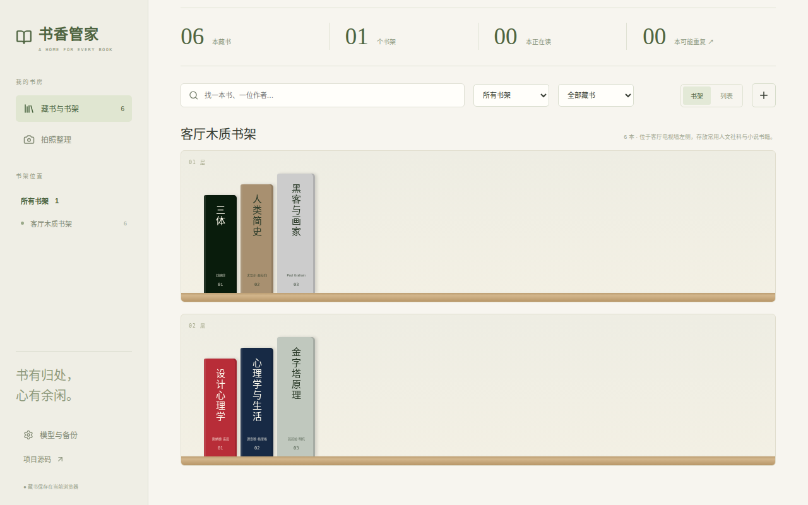

<p align="right"><a href="README.en.md">English</a></p>

<p align="center">
  
</p>

<p align="center">
  <a href="https://xiaosang.cc/bookshelf-manager/">▶ 在线使用</a>
  ·
  <a href="https://holynova.github.io/bookshelf_manager/">GitHub Pages 备选镜像</a>
  ·
  <a href="https://github.com/holynova/bookshelf_manager">GitHub 仓库</a>
</p>

书香管家是家庭藏书管理器：拍一张书架照片，AI 识别书脊（书名、作者、层数、从左向右的位置），逐本校对后归档；也可以直接手动录入。虚拟书架按层还原实体书架的样子，找书时先知道它在第几层第几个。数据只存在当前浏览器，定期导出 JSON 备份。

## 截图

<p align="center">
  
</p>

<p align="center">
  
</p>

## 工作流

1. 上传书架照片，或直接手动录入。
2. 配置支持图片输入与 JSON 输出的 Chat Completions 兼容接口；只有点击识别时才会发送照片，识别可取消。
3. 核对书名、作者、层数与从左向右的位置，勾选后追加到新书架或已有书架。
4. 搜索、查看书脊 / 列表、编辑笔记、设置未读 / 在读 / 已读、查找疑似重复藏书。
5. 定期导出 JSON 备份；导入是事务性合并，不清空已有藏书，重复导入相同记录不会再次新增。

## 功能细节

- **识别讲证据**：模型返回的不确定信息标记待补充；不生成或展示未经来源验证的豆瓣评分；原图框选位置只在模型提供有效 bounding box 且与原图对应时才显示。
- **追加不丢旧数据**：向已有书架追加时保留旧书架照片，不用新照片的框选位置。
- **演示书房**：首次打开不自动灌入演示数据，由用户主动加载；演示校对用预置样例，不代表模型识别结果。
- **隐私**：新填写的 API Key 只存当前标签页 sessionStorage，不进入备份；藏书不跨设备同步，清理浏览器站点数据前请先导出备份。
- **数据兼容**：继续使用原有 `BookshelfDatabase` IndexedDB 数据库与表，不重建或清空旧数据；旧版 rating 字段保留但不再当作外部评分展示。

## 本地开发

Node.js 24+：

```sh
npm ci
npm test     # 校验测试（识别结果与备份数据校验）
npm run build   # 构建产物输出到 docs/（GitHub Pages 发布源）
npm run dev
```

构建产物在 `docs/`，需提交构建产物才能更新线上页面。

## 技术

- React 19 + Vite + TypeScript；Dexie（IndexedDB）；Lucide 图标。
- `src/llm.ts`：可取消的真实 API 请求（Chat Completions，`response_format: json_object`），只认模型返回的有效 JSON。
- `src/catalog.ts`：校验模型识别结果与备份数据；`src/db.ts`：保留旧数据结构。

```
src/App.tsx         界面：书房 / 扫描整理 / 模型与备份
src/llm.ts          识别请求（可取消）与提示词
src/catalog.ts      识别结果与备份数据校验
src/db.ts           IndexedDB（BookshelfDatabase）
tests/              node --test 校验测试
docs/               构建产物（GitHub Pages 发布源）
```
